# Design a 3D Printed Desk Organizer

*AI disclosure: An AI agent prepared this edition from the published source lesson and its original CAD screenshots. This edition does not document a physical print, fit test, or durability test.*

## Before you start

Design a 160 × 94 mm desktop organizer with a lift-out tray and a thumb scoop for a 3-inch sticky note pad, then export both parts in one STL. Start from a blank **Solid Model** in the Reactor 3D editor and use millimeters. Turn on **Parameter Palette** in **Inspector** if needed. Positions below use world coordinates at the center of each primitive’s bottom face, with +Z up. The front wall is at negative Y. Use zero rotations unless specified.

## 01. Size the organizer base

Click **Create cube** and place it on the XY grid. Expand the part in **Browser**, select its **Cube** step, and set **Width 160 mm**, **Depth 94 mm**, and **Height 27 mm**. Select the part, name it **Organizer base**, and set **Pos X, Pos Y, and Pos Z** to **0 mm** under **Transform**.

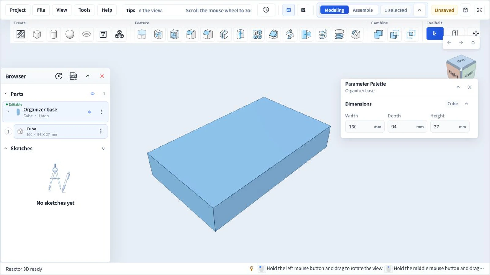

## 02. Round the four base corners

Open **Fillet** and select the four vertical corner edges. Orbit to see the back edge. Leave them in one group, set **Size** to **4 mm**, and click **Confirm** once the group shows four edges.

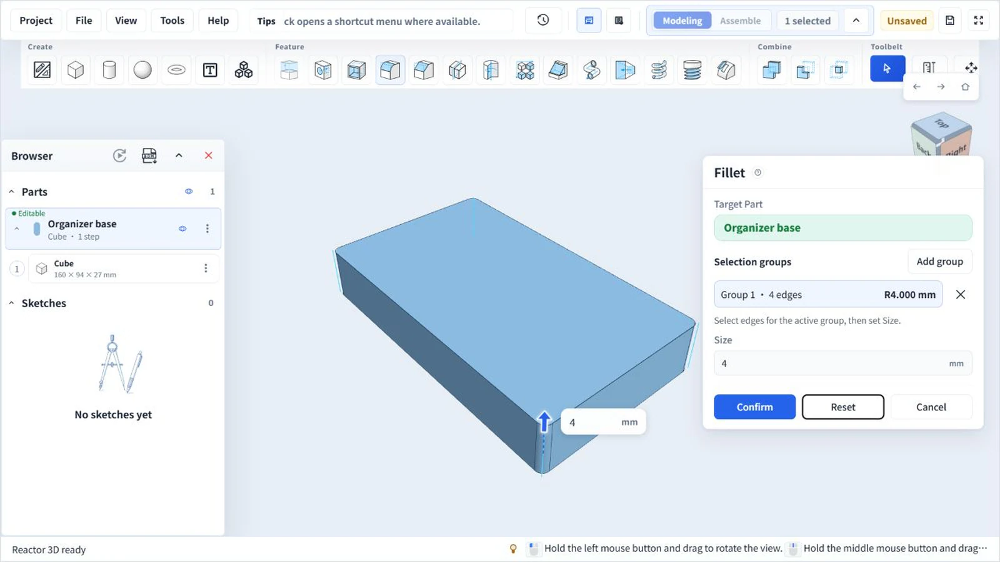

## 03. Hollow the base from the top

Select **Organizer base** and open **Shell**. Set **Wall Thickness** to **3 mm**, leave **Grow walls outward** off, and click the top face under **Remove Selected Faces**. Confirm to leave an 88 mm inside depth and a continuous 3 mm floor.

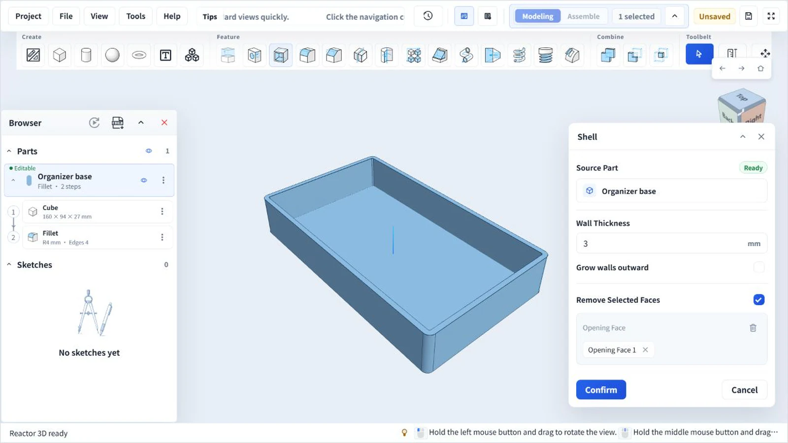

## 04. Position the thumb-scoop cutter

Place a **Cylinder** on the grid. Set **Radius 16 mm** and **Height 10 mm**. In **Transform**, set **Rot X 90°** and **Pos X, Y, Z** to **(34.75, −41, 28) mm**. The cutter crosses the front wall from **Y −51 to −41 mm**, with its lowest point at **Z 12 mm**.

## 05. Cut the thumb scoop

Select **Organizer base**, then open **Cut operation**. Add the cylinder as the **Tool part**, leave **Keep source parts** off, and click **Confirm**. The arc opens the top of the front wall without touching the 3 mm floor.

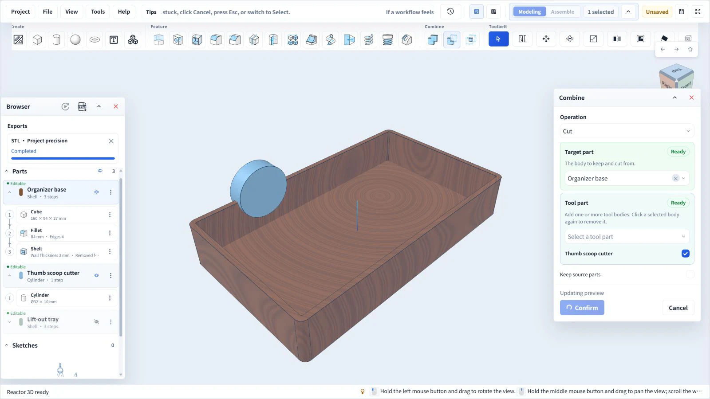

## 06. Size the lift-out tray

Hide **Organizer base** in **Browser** and place a second cube on the XY grid. Set its **Cube** dimensions to **69 × 87 × 30 mm**. Name it **Lift-out tray** and set its position to **(0, 0, 0) mm** while you work on it.

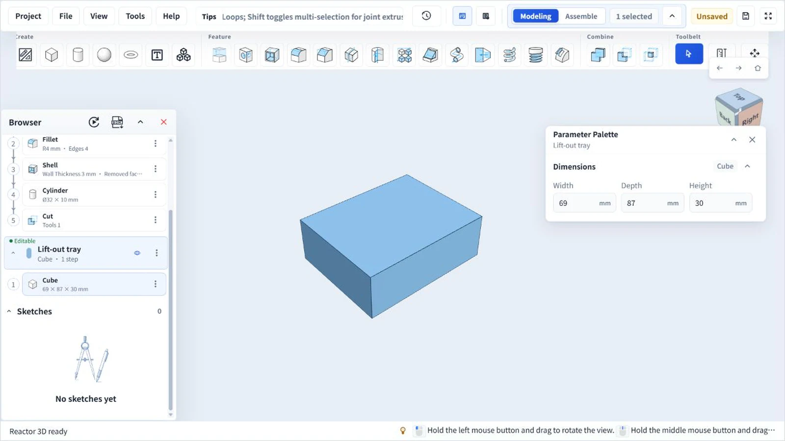

## 07. Round the tray corners

Open **Fillet** and select the four vertical corner edges of **Lift-out tray**, orbiting as needed. Set the group to **4 mm** and confirm. Rounded outside corners leave space at the tighter inside corners of the base.

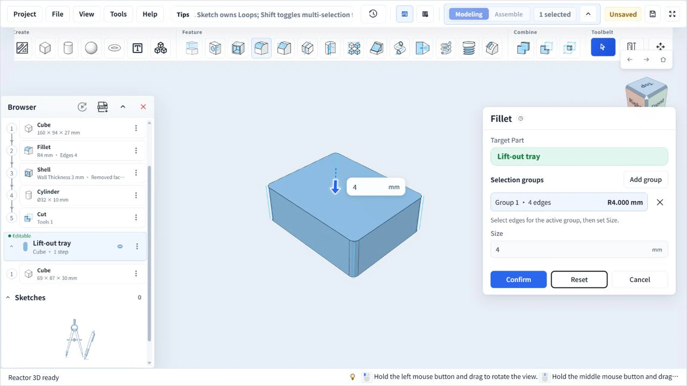

## 08. Hollow the tray

Select **Lift-out tray**. Open **Shell**, enter **3 mm** wall thickness, and select the top face to remove it. Leave **Grow walls outward** off and confirm. The tray has a nominal **63 × 81 mm** inside footprint at the straight walls.

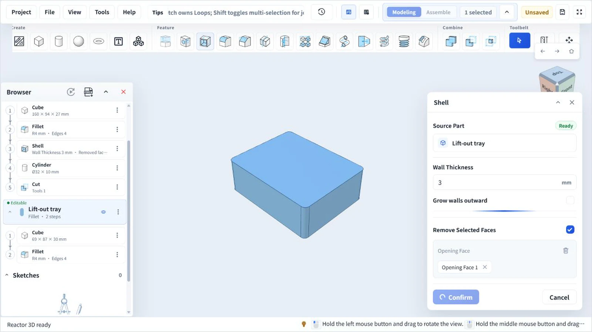

## 09. Seat the tray and check the fit

Show **Organizer base** and set **Lift-out tray** to **(−42, 0, 3) mm** with zero rotation. The tray sits on the floor, leaving **0.5 mm** at the left, front, and rear straight walls. Its rim rises **6 mm** above the base. The open bay is **84.5 × 88 mm** at the straight walls, with the scoop in front for lifting a 3-inch square note pad.

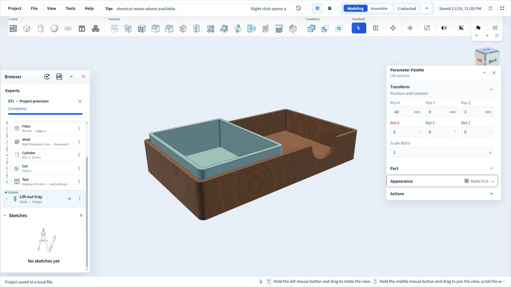

## 10. Apply walnut and matte plastic finishes

Select **Organizer base** and open **Appearance → Part → Preset**. Apply **Walnut**. Select **Lift-out tray**, apply **Matte PLA**, and enter **#90AD9D** in **Color** after picking the preset. Save the assembled project before preparing the print layout.

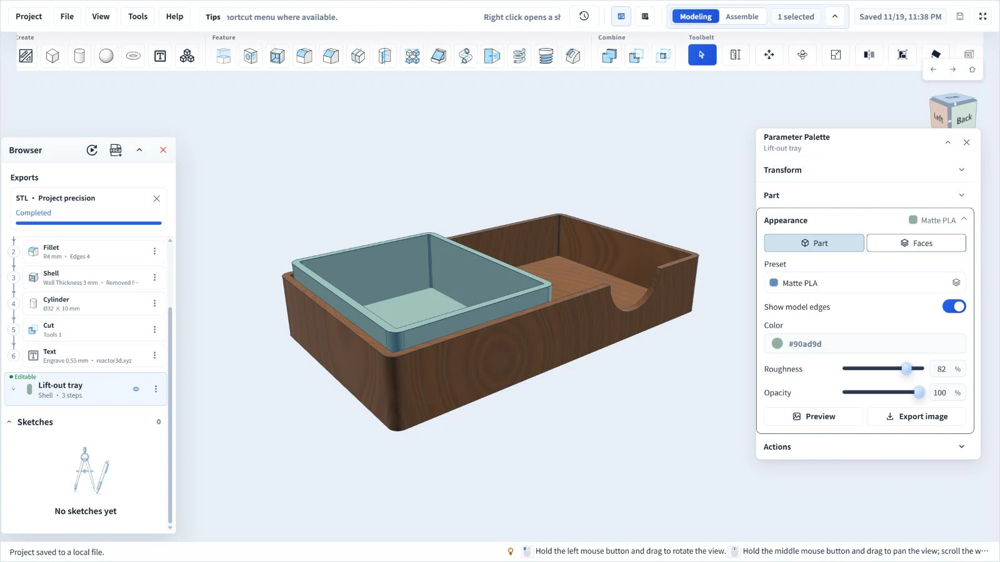

## 11. Lay out both parts for printing

Keep the base at **(0, 0, 0) mm**. Set the tray to **Rot Z 90°** and **Pos X, Y, Z (0, 88.5, 0) mm**. Both floors now sit on the XY plane with **7 mm** between the parts. The layout occupies **160 × 170 mm** before slicer brims or skirts.

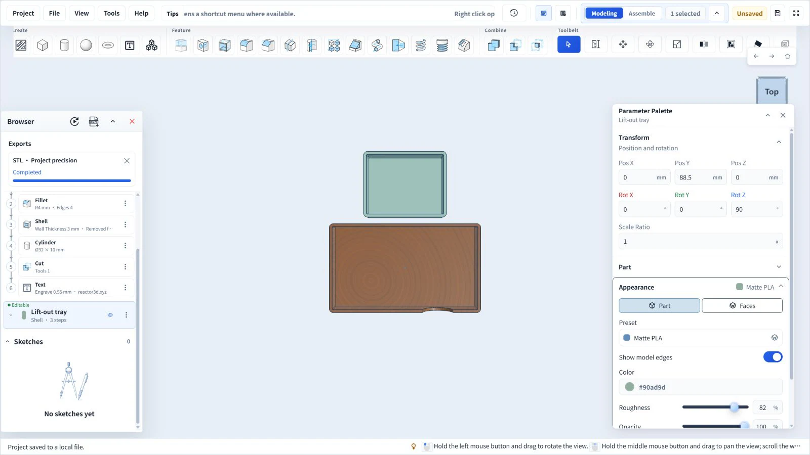

## 12. Export one STL with both parts

Choose **File → Export STL**, select **All visible models**, and check that **2** models are included. Choose **Download in browser**. Open the STL in your slicer in millimeters. Split it into two objects if you want to set different filament colors for the base and tray.

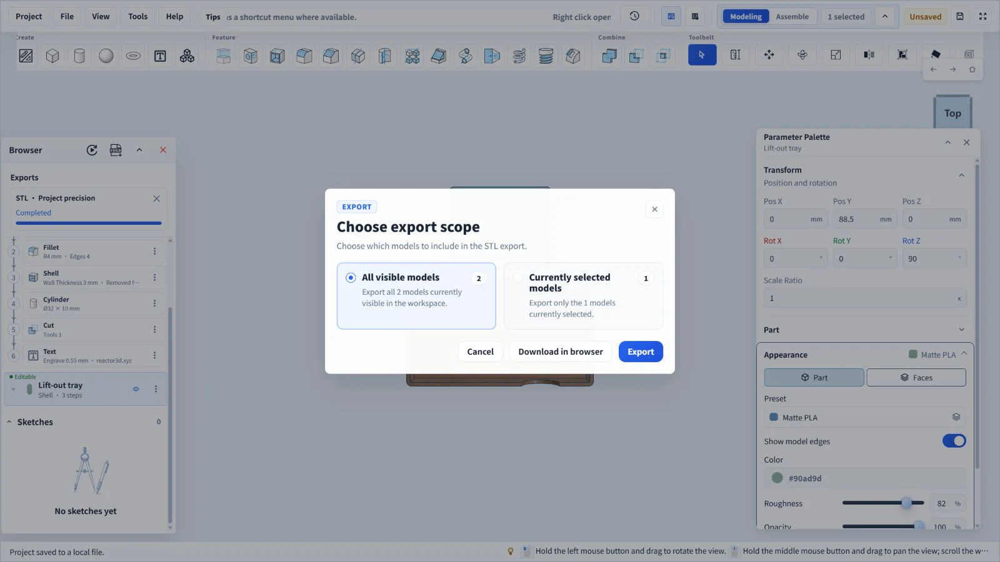

## Finished result

The **Organizer base** holds a square note pad in the open bay. Lift the **Lift-out tray** by its exposed rim to carry small items or clear the base. The downloadable **RD** in **Resources** shows the assembled position and stores the appearances. The single **STL** contains both parts in the print layout.

## Practical tips

Check the first-layer edges and dry-fit the tray after printing. If your printer widens the first layer, use the slicer’s first-layer compensation or adjust the fit after a small test print. Select the actual filament in the slicer. The Walnut and Matte PLA presets control the appearance in the editor, and STL contains the geometry.

## Download the models

* [Download the print-layout STL](lift-out-desk-organizer.stl) with both parts flat on the XY plane.
* [Download the original editable RD](https://api.reactor3d.xyz/tutorials/en/design-3d-printed-desk-organizer/resources/9f97b1ed-9603-4e7f-9d71-449fec25669c/download) with the tray in its assembled position and the CAD appearance presets.

Source: [Design a 3D Printed Desk Organizer](https://reactor3d.xyz/en/tutorials/design-3d-printed-desk-organizer), by the Reactor 3D Team. Republished with authorization from the site owner.